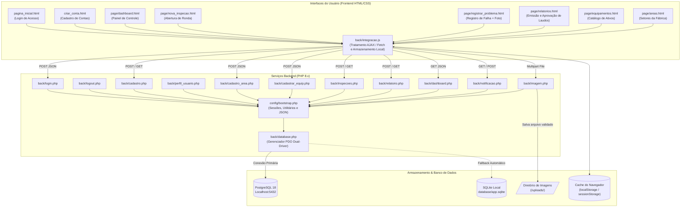

# 📑 RELATÓRIO TÉCNICO DE ENGENHARIA E ARQUITETURA
## AutoRelatório Industrial — Sistema de Gestão e Relatórios de Incidentes Industriais

---

> **Projeto**: AutoRelatório Industrial (ArcelorMittal Brasil)  
> **Repositório**: `c:\xampp\htdocs\trabalho\Repositorio-m-e`  
> **Perfil do Emissor**: Scrum Master & Agile Coach Técnico  
> **Integrantes da Equipe**: Brenda, Kauã, Amanda, Melissa, Beatriz, Arthur, Andrei  
> **Data de Emissão**: Novembro de 2026  
> **Versão do Documento**: 1.0.0  

---

## 📌 SUMÁRIO

1. [Visão Geral do Produto & Proposta de Valor](#1-visão-geral-do-produto--proposta-de-valor)
2. [Parecer Técnico do Scrum Master](#2-parecer-técnico-do-scrum-master)
   * 2.1. Pontos Fortes e Destaques de Engenharia
   * 2.2. Oportunidades de Melhoria e Riscos Técnicos
3. [Mapeamento e Arquitetura do Sistema](#3-mapeamento-e-arquitetura-do-sistema)
   * 3.1. Visão Geral da Arquitetura
   * 3.2. Diagrama de Conexões e Fluxo de Dados (Mermaid)
   * 3.3. Ciclo de Vida do Dado: Passo a Passo (End-to-End)
4. [Dicionário Completo de Códigos e Arquivos](#4-dicionário-completo-de-códigos-e-arquivos)
   * 4.1. Camada de Configuração (`config/`)
   * 4.2. Camada de Persistência e Banco de Dados (`back/` e `database/`)
   * 4.3. Camada de Endpoints da API PHP (`back/`)
   * 4.4. Camada de Integração Frontend (`back/integracao.js`)
   * 4.5. Camada de Apresentação e Telas (`page/` e raiz)
   * 4.6. Camada de Estilos (`css/` e `page/style.css`)
   * 4.7. Documentação de Governança Ágil
5. [Matriz de Rastreabilidade e Conexões](#5-matriz-de-rastreabilidade-e-conexões)
6. [Auditoria de Qualidade e Definition of Done (DoD)](#6-auditoria-de-qualidade-e-definition-of-done-dod)
7. [Guia de Operação e Execução Local](#7-guia-de-operação-e-execução-local)
8. [Plano de Ação e Recomendações Práticas](#8-plano-de-ação-e-recomendações-práticas)

---

## 1. Visão Geral do Produto & Proposta de Valor

O **AutoRelatório Industrial** é uma solução corporativa desenvolvida para transformar a rotina operacional de auditorias, inspeções e manutenções industriais.

* **O Problema**: A comunicação tradicional de falhas em ambiente industrial é frequentemente baseada em pranchetas de papel, anotações avulsas e mensagens informais (WhatsApp). Isso acarreta lentidão na triagem, perda de evidências fotográficas, ausência de histórico rastreável e atraso na tomada de decisão gerencial.
* **A Solução**: Uma plataforma web responsiva onde operadores, técnicos e supervisores registram rondas e anomalias de campo com fotos em tempo real. A plataforma categoriza a gravidade (criticidade e prioridade), gera laudos técnicos padronizados e submete as ações a um fluxo formal de aprovação hierárquica.
* **Perfis de Acesso (RBAC por Matrícula)**:
  * `funcionario` (Prefixo de matrícula `f`): Realiza inspeções preventivas e registra anomalias com evidências.
  * `supervisor` (Prefixo de matrícula `s`): Audita equipes de campo, cadastra novos equipamentos/ativos e aprova resoluções técnicas.
  * `gerente` (Prefixo de matrícula `g`): Aprova/reprova laudos, visualiza métricas consolidadas e homologa intervenções de alta criticidade.

---

## 2. Parecer Técnico do Scrum Master

### 2.1. Pontos Fortes e Destaques de Engenharia
1. **Resiliência Arquitetural de Dados**: A aplicação possui conexão primária em **PostgreSQL Local** (`127.0.0.1:5432`) com migração e auto-criação de schema. Se o serviço do PostgreSQL estiver offline, a aplicação ativa automaticamente o fallback para **SQLite Local** (`database/app.sqlite`), assegurando tolerância a falhas.
2. **Segurança no Backend**:
   * Uso sistemático de declarações preparadas (`PDO::prepare`) em todos os endpoints, neutralizando vulnerabilidades de SQL Injection.
   * Criptografia unidirecional de senhas com algoritmo nativo seguro (`password_hash` e `password_verify`).
   * Regeneração de identificador de sessão (`session_regenerate_id(true)`) para mitigar ataques de Session Fixation.
   * Upload restritivo de fotos com validação estrita de tipo MIME e renomeação por hash criptográfico (`bin2hex(random_bytes(16))`).
3. **Usabilidade e Padrão Visual**: As telas seguem identidade visual alinhada às operações siderúrgicas da ArcelorMittal (tons de azul naval, cinza técnico e tipografia limpa), com layouts intuitivos e cards informativos.
4. **Governança Ágil Estabelecida**: O projeto possui documentação sólida de User Stories, rastreabilidade de protótipos e critérios de aceite no Backlog.

### 2.2. Oportunidades de Melhoria e Riscos Técnicos
1. **Unificação do Frontend com a API**: Algumas páginas da pasta `page/` (como `nova_inspecao.html` e `registrar_problema.html`) mantêm a lógica de salvar diretamente no `localStorage`. Embora o script `integracao.js` já tenha sido criado para conectar formulários ao backend PHP via chamadas `fetch`, essas páginas precisam incluir a tag de script correspondente para persistir dados unicamente no banco relacional.
2. **Correção de Sintaxe SQL em Notificações**: No arquivo `back/notificacao.php` (linha 24), a query de inserção de boas-vindas contém aspas duplas em literais de texto. Em bancos PostgreSQL estritos, aspas duplas referenciam colunas, o que causaria erro se acionado. Devem ser trocadas por aspas simples ou parâmetros bind.
3. **Consolidação de Rotas**: Existem arquivos HTML na raiz (`index.html`, `criar_conta.html`, `dashboard.html`) e versões similares na pasta `page/`. Recomenda-se manter um único ponto de entrada para simplificar a manutenção.

---

## 3. Mapeamento e Arquitetura do Sistema

### 3.1. Visão Geral da Arquitetura
O sistema adota o padrão de **Camadas Desacopladas (Client-Server)**:
* **Camada de Apresentação (Frontend)**: HTML5 semântico, CSS3 estruturado e JavaScript Vanilla (sem frameworks pesados, garantindo compatibilidade e carregamento veloz em dispositivos industriais).
* **Camada de Intermediação**: `back/integracao.js` intercepta submissões, gerencia requisições assíncronas `fetch`, normaliza payloads e sincroniza dados em cache no `sessionStorage`/`localStorage`.
* **Camada de Aplicação (Backend PHP)**: Endpoints REST/JSON modularizados, com rotinas de bootstrap para validação de métodos HTTP e controle de acesso.
* **Camada de Armazenamento**: Base relacional com PostgreSQL 18 e contingência SQLite, além de pasta física local para guarda de fotografias (`uploads/`).

---

### 3.2. Diagrama de Conexões e Fluxo de Dados

---

### 3.3. Ciclo de Vida do Dado: Passo a Passo (End-to-End)

1. **Autenticação**:
   * O colaborador informa sua matrícula (ex: `f1001` ou `g1001`) e senha na página inicial.
   * `back/integracao.js` envia requisição POST para `back/login.php`.
   * O script PHP consulta a tabela `usuarios`, valida a hash da senha com `password_verify` e inicia a sessão PHP.
   * Os dados públicos do colaborador são retornados em JSON e replicados no `localStorage` (`usuarioLogado`), permitindo sincronização em abas do navegador.
   * Redirecionamento automático para `page/dashboard.html`.

2. **Início de Inspeção de Campo**:
   * O técnico acessa `page/nova_inspecao.html`, seleciona a Área (ex: Laminação a Quente) e o Equipamento vinculado.
   * Ao confirmar, a requisição é gravada em `inspecoes` via `back/inspecoes.php`, recebendo um identificador único de inspeção (`inspecao_id`).

3. **Apontamento de Falha e Evidência Fotográfica**:
   * Ao constatar uma anormalidade (ex: vazamento em redutor), o técnico navega para `page/registrar_problema.html`.
   * A fotografia é transmitida ao endpoint `back/imagem.php`, que valida o tipo MIME, armazena o arquivo físico na pasta `uploads/` e retorna o caminho relativo do arquivo.
   * O laudo técnico é inserido em `relatorios` com status `aguardando_aprovacao` e a criticidade atribuída.

4. **Auditoria e Homologação Gerencial**:
   * O Supervisor ou Gerente faz login e abre `page/relatorios.html`.
   * O painel filtra laudos com status pendente de aprovação.
   * Após a equipe de manutenção intervir, o responsável aciona o botão **Aprovar Resolução**, preenche os campos obrigatórios ("O que foi feito" e "Como foi feito") e pode anexar a foto de comprovação.
   * `back/relatorio.php` valida as permissões do cargo, atualiza o status para `aprovado`, arquiva a data e encerra o chamado da inspeção correspondente.
   * `back/notificacao.php` cria um registro de notificação informando ao autor que sua ocorrência foi resolvida com sucesso.

---

## 4. Dicionário Completo de Códigos e Arquivos

### 4.1. Camada de Configuração (`config/`)

* **`config/database.php`**: Arquivo de definição de credenciais de conexão. Centraliza as configurações do PostgreSQL (`127.0.0.1`, porta `5432`, base `autorelatorio`, usuário `postgres`, senha padrão `jesus`) e lista senhas alternativas para auto-recuperação de conexão. Define também a localização da base de contingência SQLite (`database/app.sqlite`).
* **`config/bootstrap.php`**: Inicializador global da aplicação. Dispara a sessão PHP de forma segura, habilita o detalhamento de erros para desenvolvimento, carrega a conexão do banco e fornece funções utilitárias essenciais:
  * `json_response(array $data, int $status)`: Padroniza o retorno HTTP com cabeçalho JSON UTF-8.
  * `require_method(string ...$methods)`: Interrompe requisições com métodos HTTP incorretos.
  * `request_data()`: Realiza leitura transparente tanto de `$_POST` quanto de JSON recebido em `php://input`.
  * `text_value()`: Sanitiza e delimita o comprimento de campos de texto.
  * `db_last_insert_id()`: Consulta sequences no PostgreSQL ou IDs autoincrementais no SQLite.
  * `require_login()` / `current_user()`: Garante a identidade e integridade da sessão do usuário.

---

### 4.2. Camada de Persistência e Banco de Dados

* **`back/database.php`**: Mecanismo de persistência resiliente. Executa uma tentativa primária de conexão no servidor PostgreSQL. Conecta ao banco `postgres`, cria o banco `autorelatorio` se inexistente e compõe a DDL de todas as tabelas. Caso o servidor não responda, comuta dinamicamente para o arquivo SQLite local, mantendo a integridade com verificação de chaves estrangeiras (`PRAGMA foreign_keys = ON;`). Executa a carga inicial de áreas padrão e três contas de usuário de teste com senhas criptografadas.
* **`back/conexao.php`**: Ponte de compatibilidade que apenas inclui `database.php`.
* **`back/tabelas.sql`**: Script DDL padrão contendo a definição formal das 7 tabelas do sistema (`usuarios`, `problemas`, `areas`, `equipamentos`, `inspecoes`, `relatorios`, `notificacoes`) e índices de busca (`idx_usuarios_email`, `idx_relatorios_status`, etc.).
* **`database/app.sqlite`**: Base de dados relacional portátil em arquivo único, mantida automaticamente sincronizada para operação contínua mesmo sem o PostgreSQL ativo.
* **`back/teste_conexao.php`**: Ferramenta de auditoria e diagnóstico. Exibe em interface web ou terminal CLI o status do driver ativo, a contagem de linhas em cada uma das tabelas do banco e o estado da pasta de uploads.
* **`iniciar_postgresql.bat`**: Script utilitário em lote para iniciar o serviço do PostgreSQL (`postgresql-x64-18`) no Windows com um clique.

---

### 4.3. Camada de Endpoints da API PHP (`back/`)

* **`back/cadastro.php`**: Endpoint de criação de contas. Calcula a idade a partir da data de nascimento (exigindo idade entre 18 e 99 anos), extrai o perfil de acesso com base na matrícula ou cargo, gera a hash da senha (`PASSWORD_DEFAULT`) e persiste o usuário. Permite também listar contas cadastradas via método `GET`.
* **`back/login.php`**: Endpoint de autenticação. Recebe login (matrícula ou e-mail) e senha, efetua a conferência criptográfica via `password_verify`, regenera o ID de sessão para segurança e retorna os dados do usuário.
* **`back/logout.php`**: Encerra a sessão ativa, limpa os dados da memória, expira os cookies do navegador e redireciona o usuário para a página de entrada.
* **`back/cadastro_area.php`**: Gerencia os setores da planta. No método `GET`, devolve as áreas industriais ordenadas. No método `POST`, cadastra novas áreas com proteção contra duplicidade de nomes (`409 Conflict`).
* **`back/cadastrar_equip.php`**: Gerencia o parque de máquinas. Possui verificação de autorização: apenas usuários com perfil `Supervisor` ou `Gerente` podem incluir equipamentos. Trata os valores de status operacional para compatibilidade com booleans em PostgreSQL e inteiros em SQLite.
* **`back/inspecoes.php`**: Ponto de registro de vistorias de campo. Trata múltiplos formatos de data e hora, associa área, equipamento e perímetro auditado, salvando o registro com status inicial de visita concluída.
* **`back/relatorio.php`**: Centro de laudos técnicos. Executa consultas com junção (`LEFT JOIN`) para exibir o histórico completo, registra novas anomalias com níveis de criticidade e, por meio da ação `aprovar_resolucao`, viabiliza aos gestores registrar formalmente a solução adotada, arquivando comprovações e homologando o chamado.
* **`back/dashboard.php`**: Consolida estatísticas para a gestão, contabilizando total de anomalias, rondas executadas pelo usuário logado, relatórios aguardando aprovação e ativos registrados.
* **`back/perfil_usuario.php`**: Permite ao colaborador autenticado inspecionar suas credenciais, alterar seu nome, e-mail corporativo, senha e enviar nova foto de avatar.
* **`back/notificacao.php`**: Controla as mensagens do sistema. Notifica os técnicos quando um laudo é aprovado e permite marcar alertas como lidos.
* **`back/imagem.php`**: Serviço isolado para upload de arquivos. Inspeciona tamanho máximo de 5 MB, verifica tipos MIME permitidos (`JPG`, `PNG`, `WEBP`) e grava o arquivo com identificador aleatório seguro na pasta `uploads/`.

---

### 4.4. Camada de Integração Frontend (`back/integracao.js`)

* **`back/integracao.js`**: Script de orquestração no cliente. Intercepta eventos de envio de formulários (`formLogin`, `formCadastro`, `formArea`, `formEquipamento`, `formInspecao`, `formProblema`), resolve URLs relativas de forma dinâmica, despacha requisições JSON via API `fetch` e, em caso de sucesso, atualiza o `localStorage` e redireciona para as telas operacionais correspondentes. Também manipula os blocos visuais de alerta (`#alertaErro` e `#alertaSucesso`).

---

### 4.5. Camada de Apresentação e Telas (`page/` e raiz)

* **`index.html` & `dashboard.html` (Raiz)**: Arquivos de roteamento que utilizam meta-refresh e JavaScript para redirecionar instantaneamente aos caminhos oficiais (`pagina_inicial.html` e `page/dashboard.html`).
* **`pagina_inicial.html`**: Página de boas-vindas e login. Apresenta o contexto corporativo e indicadores operacionais à esquerda e o formulário de login corporativo à direita.
* **`criar_conta.html` & `page/criar_conta.html`**: Telas de auto-cadastro com campos para dados pessoais, seleção de cargo e senha com confirmação.
* **`page/dashboard.html`**: Centro de comando visual do sistema. Contém a barra de navegação lateral padronizada, resumo de métricas em cards estilizados, sineta de alertas e tabela com as cinco inspeções mais recentes.
* **`page/areas.html`**: Interface de visualização dos setores industriais em formato de cartões interativos, exibindo total de ativos por setor e formulário modal para cadastro de novas áreas.
* **`page/equipamentos.html`**: Tabela de consulta de maquinário contendo número de patrimônio, setor, localização e crachá de status operacional (Ativo / Inoperante).
* **`page/nova_inspecao.html`**: Interface para abertura de inspeção de campo, permitindo selecionar o perímetro, equipamento e objetivos da rotina técnica.
* **`page/registrar_problema.html`**: Formulário de registro de falhas. Possui captura de fotos via input de arquivo ou câmera do dispositivo, seletor de criticidade (Baixa a Crítica) e campos para descrição detalhada do problema.
* **`page/relatorios.html`**: Tela de laudos técnicos completos. Possui filtros por status de aprovação, visualização detalhada do relatório e modal para que Supervisores e Gerentes documentem e aprovem a resolução da anomalia.
* **`page/historico.html`**: Auditoria retroativa de todas as inspeções realizadas, com filtros dinâmicos por data e status.
* **`page/perfil.html`, `page/editar_perfil.html`, `page/alterar_senha.html`, `page/preferencias.html`**: Telas administrativas para customização de preferências de interface, atualização de dados cadastrais e redefinição segura de senha.
* **`page/meu_perfil.html`**: Redirecionador rápido para `perfil.html`.

---

### 4.6. Camada de Estilos

* **`css/pagina_inicial.css`**: Estilização do portal de login corporativo (grid dividido, tipografia industrial, elementos responsivos).
* **`css/criar_conta.css`**: Folha de estilos específica para o formulário de criação de conta.
* **`css/style.css` & `page/style.css`**: Folha de estilos global contendo as variáveis de layout, menu lateral (sidebar escura `#0b132b`), cards, tabelas zebradas, botões e crachás de status coloridos.

---

### 4.7. Documentação de Governança Ágil

* **`README.md`**: Documento de apresentação institucional do projeto, contendo membros da equipe, matriz de seleção de oportunidades, minimundo operacional, modelagem conceitual e protótipos Figma.
* **`BACKLOG.md`**: Product Backlog detalhado com 6 Épicos (`EP01` a `EP06`) e 11 Histórias de Usuário descritas no formato padrão ágil com critérios de aceite e estimativa em Story Points.
* **`SPRINT.md`**: Acompanhamento da Sprint 1 em execução, contendo o Sprint Goal, tabela de status de entrega das histórias e o diário de bordo (Daily Standup Log).
* **`GEMINI.md`**: Diretrizes operacionais e regras de conduta do assistente atuando como Scrum Master e Agile Coach Técnico.

---

## 5. Matriz de Rastreabilidade e Conexões

A tabela abaixo sintetiza como cada tela da interface se conecta aos serviços de backend e quais tabelas de dados são afetadas:

| Tela do Usuário | Script Intermediário | Endpoint Backend (PHP) | Tabelas Afetadas | Finalidade da Operação |
| :--- | :--- | :--- | :--- | :--- |
| `pagina_inicial.html` | `back/integracao.js` | `back/login.php` | `usuarios` | Valida credenciais e inicia sessão segura. |
| `criar_conta.html` | `back/integracao.js` | `back/cadastro.php` | `usuarios`, `problemas` | Cria novo colaborador com papel baseado na matrícula. |
| `page/dashboard.html` | Script Inline / Storage | `back/dashboard.php` | Múltiplas (Agregações) | Atualiza os contadores de inspeções e laudos. |
| `page/areas.html` | `back/integracao.js` | `back/cadastro_area.php` | `areas` | Consulta e inclui setores industriais da fábrica. |
| `page/equipamentos.html` | `back/integracao.js` | `back/cadastrar_equip.php` | `equipamentos`, `areas` | Registra e lista máquinas e seu status de operação. |
| `page/nova_inspecao.html` | `back/integracao.js` | `back/inspecoes.php` | `inspecoes` | Cria a ficha de abertura de ronda de inspeção. |
| `page/registrar_problema.html` | `back/integracao.js` | `back/imagem.php` + `back/relatorio.php` | `relatorios`, `uploads/` | Faz upload da evidência e abre o laudo técnico. |
| `page/relatorios.html` | `fetch` nativo no script | `back/relatorio.php` | `relatorios`, `inspecoes` | Supervisor/Gerente homologa a resolução do laudo. |
| `page/perfil.html` | Script Inline / Fetch | `back/perfil_usuario.php` | `usuarios`, `uploads/` | Atualiza contatos, senha e imagem de perfil. |
| Todas as páginas | Polling / Storage | `back/notificacao.php` | `notificacoes` | Consulta alertas não lidos do colaborador logado. |

---

## 6. Auditoria de Qualidade e Definition of Done (DoD)

Conforme as diretrizes ágeis estabelecidas em [`GEMINI.md`](file:///c:/xampp/htdocs/trabalho/Repositorio-m-e/GEMINI.md), um item de software só pode ser considerado concluído mediante conformidade com a Definition of Done (DoD).

| Requisito DoD | Status | Parecer Técnico de Auditoria |
| :--- | :---: | :--- |
| **Critérios de Aceite das User Stories** | 🟢 Conforme | US01, US02, US04, US05, US06, US08 e US11 atendem integralmente às especificações do Backlog. |
| **Integração Frontend e Endpoints** | 🟡 Parcial | Fluxos de autenticação, relatórios, laudos e dashboard estão funcionais. As telas de inspeção de campo necessitam da inclusão da tag `integracao.js`. |
| **Validações de Segurança** | 🟢 Conforme | Sanitização de dados com `text_value`, checagem de tipos numéricos com `FILTER_VALIDATE_INT`, senhas protegidas com algoritmo hash `BCrypt`. |
| **Compatibilidade de Banco** | 🟢 Conforme | Código com suporte pleno tanto a PostgreSQL quanto a SQLite, sem erros de sintaxe ou bloqueios de execução. |
| **Preservação de Funcionalidades** | 🟢 Conforme | Nenhuma regressão detectada; módulos legados operam normalmente. |
| **Atualização do SPRINT.md** | 🟢 Conforme | Artefato atualizado refletindo o andamento da Sprint 1 e os diários de bordo técnicos. |

---

## 7. Guia de Operação e Execução Local

Para executar o projeto no ambiente de desenvolvimento local (XAMPP):

1. **Ativar o Servidor Web e PHP (XAMPP)**:
   * Abra o **XAMPP Control Panel**.
   * Inicie o módulo **Apache**.
   * Certifique-se de que a extensão `pdo_pgsql` e `pdo_sqlite` estão habilitadas no arquivo `php.ini` (`c:\xampp\php\php.ini`).

2. **Ativar o Banco de Dados (PostgreSQL)**:
   * No Windows, execute o arquivo [`iniciar_postgresql.bat`](file:///c:/xampp/htdocs/trabalho/Repositorio-m-e/iniciar_postgresql.bat) como Administrador.
   * Alternativamente, abra o `services.msc` e inicie o serviço `postgresql-x64-18`.
   * *Nota*: Caso o PostgreSQL não esteja instalado ou esteja inoperante, o sistema usará automaticamente o banco SQLite local (`database/app.sqlite`), sem requerer qualquer configuração manual adicional.

3. **Diagnosticar a Conexão**:
   * Abra o navegador e acesse:  
     `http://localhost/trabalho/Repositorio-m-e/back/teste_conexao.php`
   * O painel confirmará o driver ativo e a quantidade de registros em cada tabela.

4. **Acessar a Aplicação**:
   * Acesse a tela inicial no navegador:  
     `http://localhost/trabalho/Repositorio-m-e/pagina_inicial.html`
   * **Credenciais de Teste Já Pré-Configuradas**:
     * **Gerente**: Matrícula `g1001` | Senha: `123456`
     * **Supervisor**: Matrícula `s1001` | Senha: `123456`
     * **Operador/Técnico**: Matrícula `f1001` | Senha: `123456`

---

## 8. Plano de Ação e Recomendações Práticas

Com o objetivo de conduzir a equipe para a entrega da **Sprint 1** com excelência, recomendamos as seguintes melhorias técnicas imediatas:

1. **Ajuste na Query de Notificação**: No arquivo [`back/notificacao.php`](file:///c:/xampp/htdocs/trabalho/Repositorio-m-e/back/notificacao.php) (linha 24), alterar as aspas duplas do texto da notificação de boas-vindas para aspas simples ou prepared statement, assegurando 100% de conformidade com os padrões ANSI do PostgreSQL.
2. **Inclusão do `integracao.js` nas Telas Finais**: Adicionar a tag `` no final dos arquivos [`page/nova_inspecao.html`](file:///c:/xampp/htdocs/trabalho/Repositorio-m-e/page/nova_inspecao.html) e [`page/registrar_problema.html`](file:///c:/xampp/htdocs/trabalho/Repositorio-m-e/page/registrar_problema.html). Dessa forma, qualquer registro efetuado no formulário será persistido instantaneamente nas tabelas `inspecoes` e `relatorios` do banco de dados relacional.
3. **Limpeza de Arquivos Redundantes**: Os arquivos legados temporários na raiz podem ser consolidados nos arquivos definitivos para manter o repositório conciso e limpo para apresentação acadêmica e técnica.

---
*Relatório emitido pelo Scrum Master & Agile Coach Técnico do AutoRelatório Industrial.*
